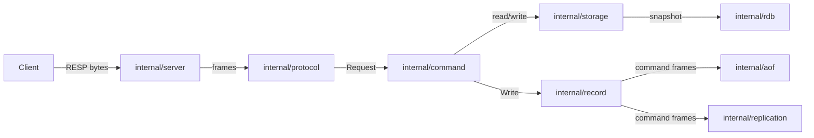

# Architecture overview

This repository implements a Redis-compatible TCP server in Go one phase at a time. It now includes the TCP server, RESP parsing and encoding, sharded in-memory storage, transactions, pub/sub, replication, RDB snapshots, append-only-file durability, memory-pressure eviction, and basic operational metrics. Each package keeps a distinct responsibility so later phases can extend the server without mixing those concerns.

## Request flow

## Package layout

### `cmd/stash`

Contains the `main` package and the production binary entrypoint. It is responsible for:

- parsing runtime flags
- creating the logger, store, and TCP server, and giving the server `command.New` to build the command executor with
- starting the server with signal-aware shutdown

### `internal/config`

Holds startup configuration such as host, port, log level, TTL eviction settings, persistence paths, replication/auth settings, `maxmemory`, and slowlog threshold. Every flag is documented in the [configuration reference](../reference/configuration.md).

### `internal/logger`

Provides a small `log/slog` initializer so the whole server shares one structured logging setup.

### `internal/aof`

Owns append-only-file durability.

Current responsibilities:

- replay RESP command streams on startup before the listener opens
- append successful mutating commands in RESP form
- apply `appendfsync` policies (`always`, `everysec`, `no`)
- rewrite the current durable state in the background for `BGREWRITEAOF`: it takes a keyspace image from the store (`storage.Image`) and writes the image's recreation commands as RESP, without knowing a value kind, how a collection is split into commands, or how a TTL is written. A Replica asks for one after a full resync (`RequestRewrite`), which runs once more after a rewrite that was already in flight
- write a keyspace image into a missing or empty file (`SeedFile`), or the file a symbolic link at the path leads to, by the same temp-file, fsync and rename steps as the rewrite

### `internal/record`

Decides where the command frames of an applied write go, and what a failed append does. It is a leaf: it imports `internal/protocol` and the standard library, and reaches the AOF and the replicas only through two ports, `Log` (`*aof.Writer`) and `Stream` (`*replication.Master`).

Current responsibilities:

- define `Origin` (a client, the Master's stream, AOF replay, or the server itself) and its capabilities
- collect a write's command frames with where each goes (`Write`, `ToAOF`, `ToReplicas`, `ToBoth`); producers say only that, and `Recorder.Record` applies the Origin: the Master's frames go to the AOF only, and replay records nothing
- apply one table to a failed append: under `always` a client's write is withheld (answered `ERR persistence failure`, not propagated) and so is the server's own; under `everysec` and `no` the failure is logged and the write still propagated; for the Master's frames it is returned, and the link ends
- report whether anything records writes (`Records`): an AOF open, or a replica attached or attaching
- encode each command frame once, into a pooled buffer: when every frame goes to the same places, the AOF and the stream are handed the same bytes, and otherwise each payload is assembled from the frames already encoded. `Log` and `Stream` copy what they keep, so the buffer is reused as soon as `Record` returns

### `internal/replication`

Both ends of a replication link. It imports `internal/protocol`, `internal/rdb` and `internal/storage`, and knows nothing of the server's connections or the command executor: a Replica's connection is the five-method `Output`, which the connection's Client output satisfies, the sequencer's attach cut is a function `Attach` is given, and a Replica's Store is the two-method `ReplicaStore`.

Current responsibilities:

- `Master`, the component through which a Master serves its Replicas: it counts the replication offset and pushes each frame to every Replica's `Output` as one step (`Propagate`, which makes it the `record.Stream`). A push only appends to the connection's Client output, which never waits on the socket, so a slow Replica holds up no writer. The Client output closes a Replica more than 256 MiB behind, counting the writes made while its full resync was sent, or one that accepts nothing for 30 seconds
- detach a Replica whose `Output` refuses a frame, under the lock the frame was counted under, so that it is pushed nothing after that frame, and then tell the server, which logs why the connection was closed
- attach a Replica at one attach cut (`Attach`): switch recording on, copy the string keyspace and register the Replica under the sequencer's cut, encode the RDB after it, and return the `FULLRESYNC` reply. Inside the cut, before the Replica is registered, its `Output` is marked a Replica's and told to hold what is pushed to it (`HoldPushes`), so every write after the snapshot waits behind the reply and follows it
- keep each Replica's base offset, the Master's offset at its cut, and translate what it acknowledges, which counts from zero, into the Master's offsets (`Ack`, `Acked`, `Info`)
- run `WAIT`'s wait (`Await`): send `REPLCONF GETACK *`, then wait, holding no lock, for enough acknowledgements, the timeout or the caller's context
- detach a Replica once (`Detach`, or the refused frame above), whoever notices first that it left
- drain at shutdown: stop pushing (`StopPropagating`), have each Replica's `Output` write what is queued for it and then shut the sending side, and wait for the Replica to close (`EndStreams`)
- `Link`, a Replica's side, over any `io.ReadWriter`: the handshake (`PING`, `AUTH`, `REPLCONF listening-port`, `PSYNC`), the full resync into the Store, then each command of the stream. It counts the Replica's offset and answers `REPLCONF GETACK` itself
- `Follow`, which keeps a `Link` attached: it dials, runs the link, and redials after a wait that doubles from one second to thirty and starts over after a completed handshake, until its context is cancelled. The dial and the wait are parameters, so its tests take no time

### `internal/protocol`

Owns RESP parsing and encoding.

Current responsibilities:

- parse RESP2 frames from a buffered TCP reader
- decode RESP frames incrementally from byte buffers without blocking, reporting incomplete frames distinctly from protocol errors
- handle fragmented bulk strings and arrays correctly
- encode simple strings, errors, integers, bulk strings, and arrays
- include minimal RESP3 placeholder types (`Boolean`, `Null`) for future expansion

### `internal/storage`

Owns the in-memory key/value store.

Current responsibilities:

- route keys to a fixed shard set and protect each shard with its own `sync.RWMutex`
- apply each single-key write, and a `DEL` of several keys, through a primitive that owns its locking, expiry and memory accounting: `mutateKey`, which the write tells whether it is shrinking (a pop, `HDEL`, `SREM`, `DEL`) and so takes only its key's shard lock even under `maxmemory` and never evicts or sweeps, or growing, and so under `maxmemory` edits a copy of the key's container and locks every shard to make room, leaving the stored value as it was if the write is refused; `mutateString` for `INCR`, `SETBIT` and `PFADD`, which edit a string in place while its length stays the same and otherwise write a resized copy, sized under `maxmemory` before it is allocated; `replaceKey` for `SET`, which replaces a value without copying it; and `deleteKeys` for a `DEL` of several keys, which like any shrinking write locks only its keys' shards
- support strings, hashes, lists, sets, sorted sets, and streams. A stored value is a TTL, an access stamp, and either a string's bytes or the payload of a collection kind. Each collection kind is one type in its own file (`list.go`, `hash.go`, `set.go`, `zset.go`, `stream.go`) that implements `kindValue`: it reports its kind and its accounted size, copies itself for a write that may be refused, says when it is empty and its key is deleted, and takes its own image, which emits its recreation commands. A hash, set or sorted set holds exactly one of its two encodings and upgrades on its own. No code outside those files switches on a kind, so a kind that lacks one of these does not compile, and `ValueKinds` is the one list of kinds, which `INFO` reads
- store TTLs in Unix milliseconds
- perform passive eviction when a read or write touches an expired key
- perform active eviction in a background loop, and again when an accounted write re-measures the keyspace (the first one after a TTL deadline has passed)
- hand each keyspace change of a write to the `storage.Changes` its caller passed, once every shard lock is released and before the write returns: the key the write changed (`Written`, and nothing when the write succeeded without changing its key, as `HDEL` of a missing field does), each key its sweep removed (`Expired`), and each key it evicted to make room (`MemoryEvicted`). The keys an accounted write removes are collected under its hold of every shard lock, so a call hands on only what it removed itself
- run each sample of the background loop through the background runner the server registers (`SetBackgroundRunner`), and tell the `Changes` the runner hands it which keys the sample removed
- copy every live key into a keyspace image (`Image`) under every shard write lock, and emit the image's recreation commands (`Recreate`) with no lock held: in key order, at most 1,024 items per command, each TTL as the absolute deadline it had, and an error for a collection with a TTL, which no command recreates. The store names the commands and their argument order (`SET`, `RPUSH`, `HSET`, `SADD`, `ZADD`, `XADD`); parsing and validating them stays in `internal/command`
- track approximate keyspace memory when `maxmemory` is enabled
- evict sampled least-recently-used candidates under memory pressure
- scan several sorted-set score ranges under one lock acquisition, so `GEORADIUS` reads only the geohash cells that cover its radius, plus two guard ranges for scores outside every cell, instead of the whole set

### `internal/command`

Translates RESP arrays into executable requests and dispatches them to handlers.

`command.New` builds the executor from the `server.Services` the server passes it: the store, the logger, the registries the server owns (WATCH, pub/sub, Slowlog), the `replication.Master` that serves the replicas, the password `AUTH` verifies, the server's INFO snapshot and AOF rewrite, and the `record.Recorder`, whose `Records` tells the sequencer whether anything records writes. It refuses a `Services` with a collaborator missing, naming the field.

A handler passes its request's effects to every Store write as the write's `storage.Changes`. Each change invalidates `WATCH` on its key while the request still holds its ordering, so no handler says which writes do. The keys the write removed on its own, by its sweep or to make room, become a `DEL` after the command's own frame in the same `record.Write`, at most 1,024 keys in each, so inside `EXEC` an eviction stays between the queued command that caused it and the next one. A command that fails, such as a write refused for memory, still records the `DEL` of the keys its sweep removed.

The server runs each request through `Handle` with a `server.Call`: the request's **Origin** (`record.Origin`: a client, the Master's replication stream, or AOF replay), the client's Client state, and whether it runs inline on the event loop. The executor copies the Call onto the request, where handlers read it; no request state travels in the context. The Origin alone decides what a request may do: only a client's request needs `AUTH`, is propagated to replicas and is recorded in the Slowlog. A Replica's link answers its Master's `REPLCONF GETACK` itself, before the executor sees it, so the executor refuses that subcommand from every Origin. A Call without an Origin or with the server's own (`OriginServer`, for evictions the server makes outside any request), a client request without its Client state, and a Master or replay request that carries one are refused.

Implemented commands cover strings, bitmaps, HyperLogLog, hashes, lists, sets, sorted sets, geospatial data, streams, transactions, pub/sub, replication handshakes, `WAIT`, `BGREWRITEAOF`, `INFO`, `SLOWLOG`, and `MONITOR`. The `commandSpecs` table registers each command with its handler, argument validator, and replication and durability flags. The [command reference](../reference/commands.md) documents that table for users.

### `internal/server`

Owns the TCP lifecycle.

Current responsibilities:

- create the registries it shares with the command executor, and build the executor once from `Services` with the constructor `cmd/stash` gives it; the executor is a required interface (`CommandExecutor`), so a method renamed on either side is a compile error. Besides `Handle` it has `RunBackgroundUnit`, which the store's background runner, the maxmemory enforcement at startup and a full resync's keyspace swap run through, and `BeginBackgroundWrite`, which guards an AOF rewrite's snapshot
- create the listener with `net.Listen`
- accept client connections in a loop
- spawn one goroutine per client (default networking mode), which queues each reply in the connection's Client output and sends the queue just before it would wait for more input, or once 4 KiB is waiting, so a client that pipelines requests gets its replies in as few writes as the requests arrived in
- send everything a connection receives through its one Client output (`Output` in `output.go`), in both networking modes: the replies to its own requests and what other connections push to it (below)
- parse → execute → respond for each request, with a `Call` each networking mode builds once per connection (an event-loop connection's runs inline); a Replica runs its link to the Master through `replication.Follow`, adapting the Store and the executor to the link's `ReplicaStore`, so each command of the stream runs with the Master's Origin, and AOF replay the replay Origin, ordered like any request
- answer a request it cannot parse with one error and close the connection, because the byte stream cannot be resynchronized (both networking modes)
- close a connection that has not authenticated within `--auth-timeout` when a password is required (a read deadline in the default mode, a timer that asks the loop to close in event-loop mode)
- hold a client that has not authenticated to small frames (arrays of at most 10 elements, bulk strings of at most 16 KiB) when a password is required; in event-loop mode the connection decodes one request at a time until then, so a request behind an `AUTH` is decoded under the limits in force after it
- provide a non-blocking connection state machine that buffers reads, parses complete requests, buffers responses, and flushes output incrementally
- optionally serve all clients from one event-loop goroutine driven by OS readiness notifications (`--event-loop`), dispatching readable and writable sockets through per-connection state machines
- maintain an active connection registry for shutdown
- load startup persistence (RDB and/or AOF) before accepting TCP connections, and write the keys an RDB snapshot loaded into a missing or empty AOF before opening it, since every later start loads the AOF and skips the RDB snapshot
- append a `DEL` of the keys the startup `--maxmemory` pass evicts to the AOF, fsynced, before accepting TCP connections, and refuse to start if that append fails
- build the `record.Recorder`, give it the AOF writer once the file is open and the `replication.Master` as its stream, and pass it to the executor, which records each write through it, a Background unit's `DEL`s included, as the server's own writes
- maintain monitor and slowlog registries for operational visibility
- expose server stats used by `INFO`
- stop cleanly when the process receives `SIGINT` or `SIGTERM`; a second signal ends the process immediately with the default action, which abandons a shutdown that is stuck
- on shutdown, stop handing writes to the replicas and give them up to a second to take what is queued for them: the default mode's handlers leave a replica's connection open when the context is cancelled, and the event loop keeps serving the replicas (below). Shutdown ends each replica's stream (`replication.Master.EndStreams`): once the stream has reached the socket, the replica's Client output shuts only the sending side, and shutdown waits for the replica to close its own, because closing the socket with data still in the kernel's send queue lets the replica's next acknowledgement reset the connection and discard that data. It logs a warning when a replica has not closed its connection by the end of the second
- on a Replica, replace the keyspace with each full resync's snapshot as a Background unit, and then have the AOF rewritten from it (`aof.Writer.RequestRewrite`), since the file holds the history of the keyspace it replaced
- stop, returning the error, when the accept loop fails with an error that is not temporary; a Replica's link to its Master ends with the server

### `test`

Contains integration tests that verify the server end to end over a real TCP connection.

## Design notes

### Why shard-local store locks?

The store now uses a fixed shard set with one `sync.RWMutex` per shard. Single-key commands only lock the owning shard, while multi-key commands group keys by shard and lock shard IDs in deterministic order to avoid deadlocks. The exception is a growing write under `maxmemory`, which locks every shard in ascending order because making room for it can evict a key from any of them. A shrinking write never needs room, so it keeps to its own shard even then.

### Why RESP3 placeholders now?

The user requested RESP3-aware structure, but full RESP3 support is out of scope for the current implementation. The protocol package therefore exposes lightweight placeholder types so later expansion does not require redesigning the core abstraction.

### Why one Client output per connection?

A connection is sent two kinds of bytes: the replies to its own requests, and what it did not ask for at that moment (pub/sub messages, `MONITOR` events, and for a replica the replication stream). Both go through the connection's `Output`, an ordered queue, so they reach the socket in the order they were produced. Appending to it never waits on the socket. That is what lets `PUBLISH` and `MONITOR` fan out under the registry's read lock, and under the sequencer's gate and stripes, without a subscriber that stopped reading holding up the publisher or anyone waiting behind it. A push does not wait for a large reply to be copied into the queue either. A reply whose own bulk strings add up to 2 MiB or more, as the snapshot of a full resync does, is encoded before the queue's lock is taken and queued as a buffer of its own, so a write that is pushed to a replica during its full resync does not wait for the snapshot. Bulk strings inside an array do not count: a large array reply is still encoded under the lock, and no connection that is pushed to is sent one.

Each networking mode writes the queue out with its own driver. In the default mode the connection's goroutine writes its replies, before it waits for input and once 4 KiB is waiting, and a pump goroutine runs only while pushed output waits and nobody is writing. The goroutine writes what was queued when it began and no more: what other connections push while it writes, such as the writes made while a replica is sent its snapshot, is the pump's to write, so the goroutine gets back to reading the connection, which for a replica means its acknowledgements. If the goroutine finds the pump writing, it leaves its replies to the pump. The `Output` counts the bytes its socket has taken and records where the connection's latest reply ends in the queue, so it knows how much is left to write before that reply is out: the unwritten replies and whatever was pushed ahead of them. The goroutine waits for the pump only while that is more than 1 MiB, so a client that does not read what it is sent stops having its requests run. What is pushed after the latest reply never makes it wait: a replica's goroutine waits for the pump to write the full resync reply, when a write held behind that reply gave the pump the socket, and then reads acknowledgements however much of the stream is waiting. In `--event-loop` mode the loop writes every connection.

The order between a reply and a pushed message is fixed where the push is queued. A message published before a request runs is ahead of that request's reply. A request that changes what is pushed to its own connection calls `HoldPushes` at that change: `SUBSCRIBE` and `MONITOR` inside the registry's critical section, a `PSYNC` inside its attach cut, before the Master registers the replica. Whatever the change lets in then waits behind the request's reply, so no message precedes the `SUBSCRIBE` acknowledgement and the replication stream follows the `FULLRESYNC` reply. `UNSUBSCRIBE` holds nothing: a message published before it is already queued ahead of its reply, and none is queued after.

One policy bounds pushed output in both modes. A connection that receives pub/sub messages or `MONITOR` events is closed once 32 MiB of output waits for it (a replica at 256 MiB, as in Redis). All such connections together may hold 128 MiB, replicas excluded: past that, the one with the most waiting is closed until the total fits, so fanning a message out to many slow subscribers cannot multiply memory. Each `Output` keeps an atomic count of what waits for it, and the budget reads those counts without taking any connection's lock. A replica whose socket takes nothing for 30 seconds of a batch of output it has been offered is closed too. Output that no writer has offered to the socket does not count, since the replica is not failing to take it: replies that are not flushed yet, and a stream held behind a reply that has not been produced. Only the writer can say whether the socket takes anything. In the default mode the writer stays inside a blocking write while a batch is on offer, so the rule's timer closes the connection. The event loop's writes return at once, and the loop may have run one request for the whole 30 seconds without trying the socket again, so there the timer lists the connection for the loop (`outputDriver.retry`) and the loop's next write gives the verdict: the replica is closed if the socket takes nothing then, and has another 30 seconds if it takes something. Replies to a connection that receives no pushes are not subject to these limits, because a reply can be as large as a stored value; in `--event-loop` mode the 512 MiB per-connection limit applies to them.

Locks are taken in the order registry or `replication.Master`, `Output`, budget: the Master pushes a frame to every replica's `Output` under its own lock, as a registry pushes a message to its subscribers. An `Output`'s lock is never held across a socket write, and closing an `Output` never waits for a write in progress or touches a registry or the Master: the connection's teardown takes the Client state out of the registries and detaches the replica.

### Why an opt-in event loop?

The `--event-loop` flag replaces goroutine-per-connection networking with a single event-loop goroutine backed by OS I/O multiplexing, so many idle connections cost file descriptors instead of goroutine stacks.

Platform support is limited to the following systems:

- Linux uses `epoll` and macOS uses `kqueue`, both through the standard-library `syscall` package with level-triggered readiness.
- Every other platform (including Windows) logs a warning and falls back to the default goroutine-per-connection path, so the flag is safe to set everywhere.

Inside the loop, each accepted socket is non-blocking and belongs to a connection state machine. Readable sockets feed buffered bytes into request parsing and command execution. Writable sockets flush the connection's Client output under backpressure. When another connection or goroutine pushes to a connection, its Client output lists the connection once on the loop's dirty list. The loop takes that list on every iteration, after the events of the one before, so what a `PUBLISH` on the loop queued for its subscribers is written without a wakeup. A pusher on another goroutine wakes the poller only while the loop is waiting in it: the loop announces the wait, looks at the list once more, and wakes itself if anything is there, so no wakeup is lost between the two.

The event loop executes one request at a time and interleaves output flushes. It pauses reads and execution when a connection's output passes a 1 MiB high-water mark, then resumes when the socket drains. When a peer half-closes, the server finishes the parsed pipeline and flushes its replies before closing the connection. When the server shuts down, or accepting fails, the loop stops accepting and closes every connection but the replicas'. It keeps writing to the replicas what the Master pushes to them. Once shutdown has stopped that and ended a replica's stream, the loop shuts that connection's write side when its output has drained, and closes it when the replica closes its own. The loop keeps no time of its own: shutdown closes the connections that are still open when its grace of a second has passed, and the loop returns when none is left.

Commands execute inline on the loop goroutine. In event-loop mode, a command that would block, such as `BLPOP` on an empty list or `WAIT` for pending replica acknowledgements, returns an explicit error instead of stalling every connection. Immediately satisfiable forms still succeed. The goroutine-per-connection path remains the default.

### Why order writes and transactions explicitly?

The sharded store makes each operation atomic, but two clients' operations can still interleave. Two things depend on their order: `EXEC`, which must see its watched keys unchanged and its queued commands run without others in between, and the AOF and replicas, which must see two writes to one key in the order they were applied.

The command executor therefore has a sequencer. Every request holds a read-write lock shared while it executes; `EXEC` holds it exclusive. A request refused for its Call, or because its client has not authenticated, is refused before it takes any sequencer lock, so it neither waits for nor holds up another request. A request that writes also holds the lock for the stripe (one of 64) of each key it writes, from before it executes until its command frames have been appended to the AOF and handed to the replicas. `Handle` records them itself (`record.Recorder`) before it releases the locks, so a write's locks never leave the executor, and `BLPOP` records its pop inside the attempt that holds its stripe. Writes on different stripes commute, except under `--maxmemory` (below), so the AOF and the replicas may receive them in different orders; the Recorder takes no lock of its own. Writers to different keys still run in parallel; writers to the same key, and any write whose keys the command table does not declare, are ordered. While `--maxmemory` is set, an accounted write holds every stripe too: making room for it can cause a memory-pressure eviction, or a TTL eviction by its sweep, in any stripe, so it no longer commutes with a write of an evicted key, which must not be recorded ahead of the eviction's `DEL`. Only the shrinking writes the command table marks `shrinks` (`DEL`, the pops, `HDEL`, `SREM`, and `BLPOP`, which orders itself by its key), which never evict, keep their own stripes. Work the server does on its own initiative runs as a Background unit (`RunBackgroundUnit`): a sample of the expiry sweep, the maxmemory enforcement at startup, and the keyspace swap of a replica's full resync. A unit holds every stripe, as a write of unknown keys does, hears its keyspace changes through the same `Changes` a request's handler passes, and records the `DEL` of the keys it removed with Origin Server before it releases the stripes, so an eviction and a later write of the same key cannot be reordered. The snapshot an AOF rewrite takes holds every stripe for a moment too, so that a snapshot and a command halfway to the log cannot be. When there is no AOF and no replica, attached or attaching, there is nothing to order, and the stripes are skipped.

`PSYNC` attaches a replica at one moment, its attach cut, so that every write is in exactly one of the snapshot the replica is sent and the stream that follows it. It switches ordering on while holding the read-write lock exclusive for a moment, which waits for any write that skipped its stripes, and then holds the lock shared and every stripe while it copies the snapshot and registers the replica. Writers wait for the copy, as they already waited for the store's shard locks it takes, and readers keep running; encoding the RDB happens after. Inside the cut the connection's Client output is told to hold what is pushed to it, so every write from then on waits there and is sent after the full resync reply, which releases it. Because `EXEC` holds the lock exclusive, which the cut would wait for, `PSYNC` is refused inside `MULTI`. After `PSYNC`, the connection carries the stream alone: the request pipeline both networking modes share runs what the replica sends, such as its acknowledgements, and drops the replies, and a frame that cannot be parsed closes the connection without an error reply, so that no reply can land among the stream's frames. No push can either: `MONITOR` from a replica is ignored, and `SUBSCRIBE` from one makes the executor return `server.ErrCloseConnection`, on which both networking modes close the connection.

Writers on different stripes, and the `REPLCONF GETACK` that `WAIT` sends, still hand frames to the replicas at the same time. Counting a frame's replication offset and queueing it for every replica therefore happen under one lock, the `Master`'s, taken after the stripes, so that each replica receives the stream in the order its offsets were counted: a replica that acknowledges an offset has every frame that ends at or before it, which `WAIT` relies on. The lock covers adding to the offset and copying the frame into each replica's Client output, not executing the command or writing to a socket. A replica whose Client output refuses the frame, because its connection is closed, is detached under the same hold of the lock, so no later frame reaches it. Registering a replica, at its attach cut, reads the master offset under the same lock, as the replica's base: the replica is sent exactly the frames counted after it and counts its own offset from zero, so its base plus what it acknowledges is its position in the master's offsets, which `WAIT` compares with a client's last write. While no replica is registered, a client write's frames are only counted, without the `Master`'s lock: the attach cut registers a replica only when no write sits between being applied and having its frames counted, so each write is counted either at or below the new replica's base, with its effect in the snapshot, or after the replica is registered, when it takes the lock. The `GETACK`, which holds no sequencer lock, always takes it, and so do the `DEL`s of a Background unit, which the Recorder never propagates as ordered.

A blocking command (`BLPOP`, `WAIT`) waits with nothing held and takes the locks only for each attempt; inside a transaction it does not wait at all.

### Why keep persistence separate from replication?

Replication and AOF both reuse RESP-encoded command frames, but they serve different correctness goals:

- replication forwards commands to live replicas
- AOF records only durable state mutations for crash recovery

So each command frame of a write says where it goes (`record.ToAOF`, `ToReplicas` or both), and one `record.Write` carries all of them. That lets the server replicate transient commands like `PUBLISH` without persisting them, and log `XADD` without replicating it, while the `DEL` of a key `XADD` evicted under `maxmemory` goes to both. The Recorder then applies the write's Origin (the Master's frames go to the AOF only) and decides what a failed append does to the reply and to propagation, in one table (see `record.Recorder`).
